# Palmer Penguins Species Classifier: MLflow Lab

An MLflow experiment-tracking project that predicts a penguin's species (**Adelie**, **Chinstrap**, or **Gentoo**) from body measurements, island, and sex. Four models are compared with cross-validation, the best one is registered automatically in the MLflow Model Registry, and it is served as a REST API by its `champion` alias.

This project is based on the MLflow Lab (Lab1) from the course. I first ran the original notebooks (diabetes and wine quality regression), fixed what was needed for them to run on MLflow 3, then rebuilt the lab with a new dataset, a preprocessing pipeline, model comparison, logged artifacts, automatic model registration, alias-based serving, and tests.

---

## Changes from the original lab

| Area                 | Original lab                                                         | This version                                                                            |
| -------------------- | -------------------------------------------------------------------- | --------------------------------------------------------------------------------------- |
| Dataset              | Diabetes (built into scikit-learn) and Wine Quality, both regression | Palmer Penguins, multi-class classification, loaded from a CSV in `data/`               |
| Data cleaning        | None                                                                 | Rows with no measurements removed, missing `sex` filled inside the model pipeline       |
| Train/test split     | Random                                                               | Stratified 80/20, so each species keeps its share                                       |
| Code structure       | Notebooks                                                            | Python modules in `src/` (data, training, prediction client)                            |
| Tracking backend     | Notebooks writing directly to a local store                          | Local MLflow tracking server, all logging goes through it                               |
| Experiments and runs | Everything in "Default", random run names                            | Named experiment `penguin-species`, one named and tagged run per model                  |
| Models               | One model per notebook                                               | Logistic Regression, SVM, Random Forest, and Gradient Boosting compared in one script   |
| Metrics              | RMSE, MAE, R2 on one split                                           | 5-fold cross-validation (mean and std) plus held-out test metrics, including log loss   |
| Artifacts            | Only the model                                                       | Model plus a CV confusion matrix image and a per-species classification report          |
| Logged model         | Bare model                                                           | Full preprocessing pipeline with a signature and an input example                       |
| Model registry       | Registered only when a condition on the store type was met           | Best run selected by CV log loss and registered automatically, with tags explaining why |
| Serving              | Hardcoded `mlruns/0/<run-id>/...` path                               | `models:/penguin-species-classifier@champion`, no run IDs                               |
| Testing              | None                                                                 | 19 pytest tests for the data, training code, and the served API                         |

**Why commit the CSV instead of downloading it?** The data could be downloaded at runtime, but then every run would need internet access and would depend on the source site being available. Keeping the CSV in the repo makes the project self-contained and reproducible.

---

## Dataset

The [Palmer Penguins dataset](https://archive.ics.uci.edu/dataset/690/palmer+penguins-3) from the UCI Machine Learning Repository (Gorman, Williams and Fraser, 2014) contains measurements of 344 penguins from three islands in the Palmer Archipelago, Antarctica, collected by Dr. Kristen Gorman and the Palmer Station Long Term Ecological Research (LTER) program.

The CSV in `data/` was downloaded from the [seaborn data repository](https://github.com/mwaskom/seaborn-data/blob/master/penguins.csv), which distributes the same 344 penguins as a single file.

| Feature             | Description                                |
| ------------------- | ------------------------------------------ |
| `bill_length_mm`    | Bill (culmen) length in mm                 |
| `bill_depth_mm`     | Bill (culmen) depth in mm                  |
| `flipper_length_mm` | Flipper length in mm                       |
| `body_mass_g`       | Body mass in grams                         |
| `island`            | Biscoe, Dream, or Torgersen                |
| `sex`               | MALE or FEMALE (missing for some penguins) |
| `species`           | Target: Adelie, Chinstrap, or Gentoo       |

---

## Project structure

```
MLOPS-Lab4/
├── data/
│   └── penguins.csv          # Palmer Penguins dataset
├── original_lab/             # Original notebooks, scripts, images, and course notes
├── screenshots/              # Screenshots
├── src/
│   ├── data.py               # Loads, cleans, and splits the data
│   ├── train.py              # Trains, compares, logs, and registers the models
│   └── predict.py            # Sends penguins to the served model
├── tests/
│   ├── test_data.py          # Data loading, cleaning, and split tests
│   ├── test_train.py         # Pipeline, metrics, and model selection tests
│   └── test_api.py           # Tests against the served champion model
├── .gitignore
├── pytest.ini
├── requirements.txt          # Pinned dependencies
└── README.md
```

---

## Setup

Requires Python 3.12. From the repo root:

```bash
python3.12 -m venv .venv
source .venv/bin/activate
pip install -r requirements.txt
```

`xgboost` is only used by the original lab's `serving.py`. On macOS it also needs `libomp` (`brew install libomp`).

---

## Running the lab

All commands are run from the repo root with the virtual environment active. Steps 1 and 3 start servers, so each needs its own terminal tab.

**1. Start the MLflow tracking server**

```bash
mlflow ui --port 5001
```

The UI opens at http://127.0.0.1:5001.

**2. Train, compare, and register the models**

```bash
python -m src.train
```

This trains all four models, logs each as a run in the `penguin-species` experiment, registers the best one as `penguin-species-classifier`, and moves the `champion` alias to it.

**3. Serve the champion model**

```bash
export MLFLOW_TRACKING_URI=http://127.0.0.1:5001
mlflow models serve --env-manager=local -m "models:/penguin-species-classifier@champion" -h 127.0.0.1 -p 5002
```

**4. Send penguins to the API**

```bash
python -m src.predict
```

**5. Run the tests**

```bash
pytest -v
```

The API tests in `test_api.py` need the model server from step 3. If it is not running, they are skipped with a clear reason instead of failing, so the other tests still run anywhere.

---

## MLflow improvements

**Tracking server and named experiment.** All runs are logged through the local tracking server into the `penguin-species` experiment. Each run has a readable name (`svm_rbf`, `random_forest`, ...) and `dataset` and `model_type` tags.

**Cross-validation metrics.** Each model is scored with 5-fold stratified cross-validation on the training data, and the mean and standard deviation of accuracy, macro F1, and log loss are logged. Test-set metrics are logged separately, with `cv_` and `test_` prefixes so it is clear where each number came from.

**Artifacts.** Each run saves a confusion matrix image (`mlflow.log_figure`) and a per-species classification report (`mlflow.log_text`), both built from the cross-validation predictions.

**Logged pipeline with a signature.** The model is saved together with its preprocessing (imputers, one-hot encoder, scaler) as one scikit-learn pipeline. The served model therefore accepts raw penguin data, including a missing `sex`. The signature records the expected input columns, and MLflow rejects requests that do not match it.

**Automatic registration with an alias.** After training, the script picks the run with the lowest CV log loss, registers it, tags the version with `selected_by` and `run_name`, and points the `champion` alias at it. Running the script again creates a new version and moves the alias, so serving never needs a run ID.

**Why choose by log loss?** All four models reach a test F1 of 1.0 and CV F1 scores within about 0.02 of each other. Log loss also measures how confident the correct predictions are, so it still separates models when they are all nearly perfect.

---

## MLflow 3 compatibility fixes for the original lab

The original notebooks were written for an older MLflow version. To run them on MLflow 3.18, I made these changes:

- **Tracking URI.** Added `mlflow.set_tracking_uri("http://127.0.0.1:5001")`, because logging a model requires going through the tracking server.
- **skops trusted types.** MLflow 3 saves scikit-learn models in the safer skops format, which asks for permission to save some internal types. Added `skops_trusted_types=["sklearn.tree._tree.Tree"]` for the Random Forest.
- **Loading and serving by URI.** Replaced hardcoded `mlruns/0/<run-id>/...` paths with `runs:/<run-id>/model`, because MLflow 3 stores models in a different location.
- **Serving port.** Served the model on port 5002, since the tracking server uses 5001.

With these fixes, the served Linear Regression model in `serving.ipynb` returned exactly the same predictions as the instructor's notebook output. One small issue in the original: `serving.ipynb` trains a Linear Regression but registers it under the name `RandomForest`.

---

## Tests

| File            | Tests | What they check                                                                                                                                                                                 |
| --------------- | ----- | ----------------------------------------------------------------------------------------------------------------------------------------------------------------------------------------------- |
| `test_data.py`  | 5     | The CSV has the expected shape, cleaning drops only rows without measurements (on the real file and a small hand-made table), and the split is stratified and reproducible                      |
| `test_train.py` | 10    | The pipeline predicts only known species, handles a missing `sex` and an unseen island, metrics have valid ranges, every model in `MODELS` trains, and `select_best` picks the lowest log loss  |
| `test_api.py`   | 4     | The served model passes a health check, predicts the three sample penguins correctly, scores at least 95% accuracy on the whole test set over HTTP, and rejects a request with a missing column |

All **19 tests pass**.

---

## Results

### Data cleaning

The raw data has 344 penguins. Two rows have no measurements at all and were removed, leaving **342**. Another 9 penguins are missing only `sex`. These were kept, and the pipeline fills in the most common value, so the served model can handle the same gap. There are no duplicate rows.

The species are unbalanced: 151 Adelie, 123 Gentoo, and 68 Chinstrap after cleaning. The stratified split gives 273 training and 69 test penguins (30 Adelie, 25 Gentoo, 14 Chinstrap in the test set).

### Model comparison

| Model                     | CV accuracy | CV macro F1 | CV log loss | Test macro F1 |
| ------------------------- | ----------- | ----------- | ----------- | ------------- |
| **SVM (RBF, calibrated)** | **0.996**   | **0.995**   | **0.031**   | 1.000         |
| Logistic Regression       | 0.993       | 0.991       | 0.037       | 1.000         |
| Random Forest             | 0.978       | 0.975       | 0.086       | 1.000         |
| Gradient Boosting         | 0.978       | 0.974       | 0.110       | 1.000         |

Every model classifies all 69 test penguins correctly. Penguin species are easy to tell apart from these measurements, and the test set is small, so the test score alone cannot pick a model. Cross-validation shows a clear pattern instead: the two linear models (SVM and Logistic Regression) beat the tree models on every CV metric, and they are also more stable across folds. The SVM is best on all three CV metrics, so it was registered as the champion.

### Confusion matrix (5-fold CV, SVM)

Out of 273 training penguins, each predicted by a model that did not see it, the SVM gets **272 right**.

|               | Adelie | Chinstrap | Gentoo |
| ------------- | ------ | --------- | ------ |
| **Adelie**    | 121    | 0         | 0      |
| **Chinstrap** | 1      | 53        | 0      |
| **Gentoo**    | 0      | 0         | 98     |

| Species   | Precision | Recall | F1    |
| --------- | --------- | ------ | ----- |
| Adelie    | 0.992     | 1.000  | 0.996 |
| Chinstrap | 1.000     | 0.981  | 0.991 |
| Gentoo    | 1.000     | 1.000  | 1.000 |

Gentoo is never confused with another species, since Gentoos are clearly larger, with longer flippers and heavier bodies. The only mistake is one Chinstrap predicted as Adelie. These two species are similar in size, flipper length, and mass and differ mostly in bill length, and Chinstrap is also the smallest class, with the least data to learn from.

### Experiment: calibrating the SVM

In scikit-learn 1.9, `SVC(probability=True)` is deprecated, and the suggested replacement is `CalibratedClassifierCV(SVC(), ensemble=False)`. I switched to it to remove the warnings, and it also changed the result.

| Metric      | `SVC(probability=True)` | `CalibratedClassifierCV` |
| ----------- | ----------------------- | ------------------------ |
| CV macro F1 | 0.995                   | 0.995                    |
| CV log loss | 0.041                   | 0.031                    |

The predicted species did not change, but the probabilities became better calibrated, which lowered the log loss. Before the change, Logistic Regression (0.037) had the lowest log loss and would have been chosen as the champion. After it, the SVM is best on every CV metric. This shows that the selection rule depends on probability quality, not only on which labels are predicted.

### Serving

The champion model served at `models:/penguin-species-classifier@champion` predicts the three sample penguins in `predict.py` correctly, including a Gentoo sent with no `sex` value. The pipeline fills in the missing value, and the API returns `200 OK`.

---

## Screenshots

### Original lab

| `starter.ipynb` predictions                       | Runs in the Default experiment             |
| ------------------------------------------------- | ------------------------------------------ |
| 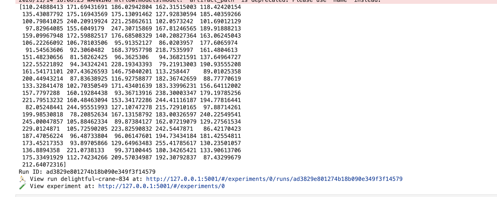 | 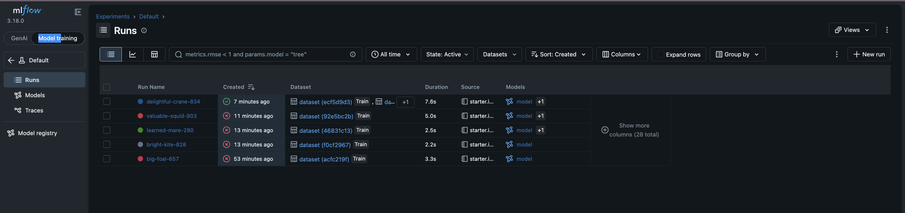 |

| Run details                                       | ElasticNet wine quality output                  |
| ------------------------------------------------- | ----------------------------------------------- |
| 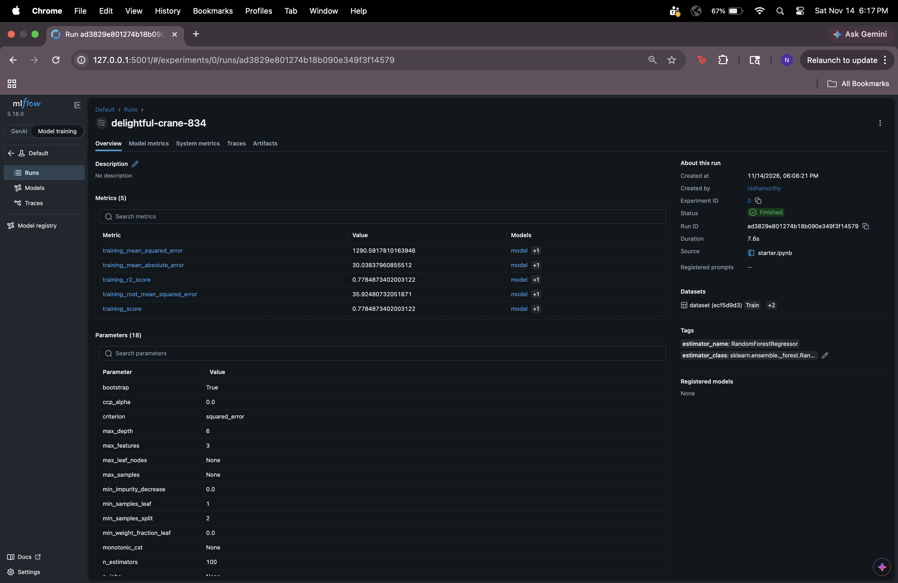 | 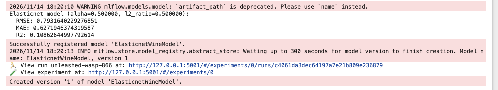 |

| Model registry                         | Served model predictions                          |
| -------------------------------------- | ------------------------------------------------- |
| 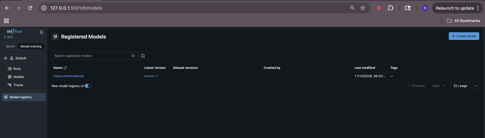 | 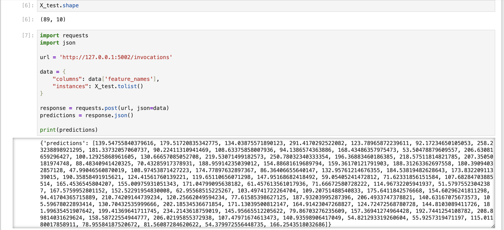 |

**Model server receiving the request**

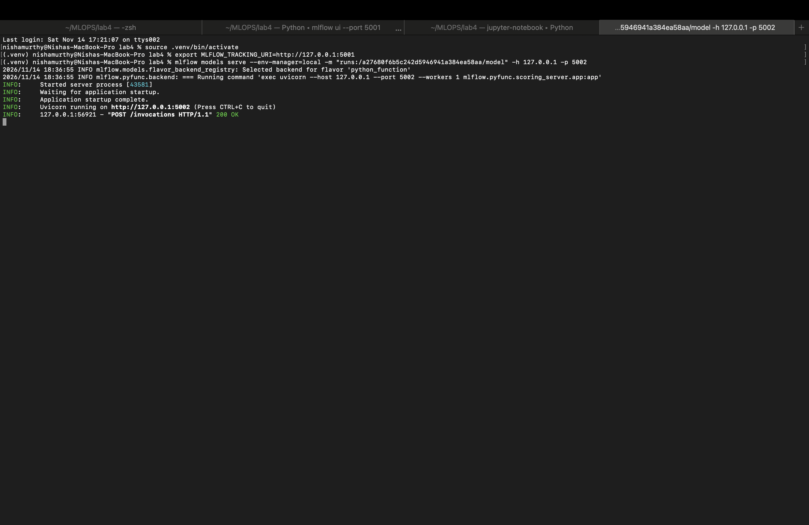

### This version (Palmer Penguins)

**Dataset overview: rows, missing values, and species counts**

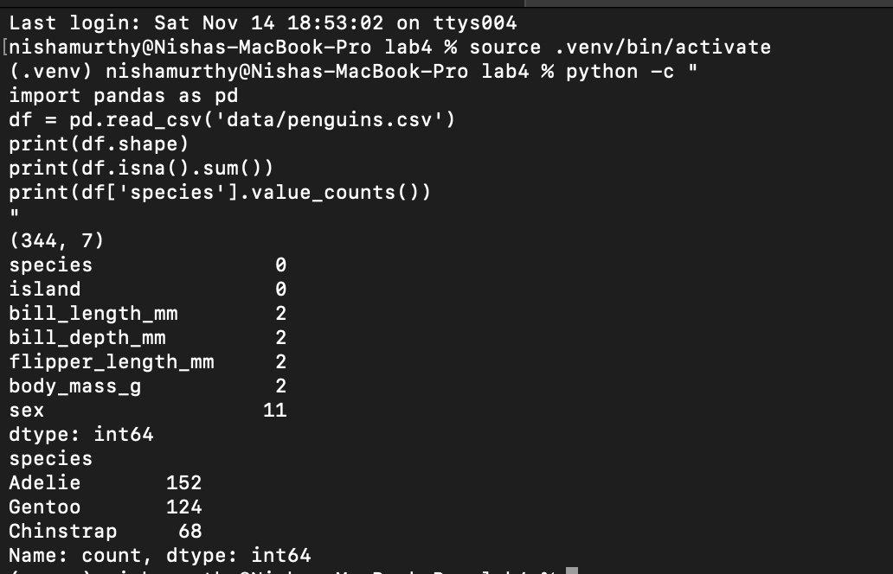

**Cleaning and stratified split**

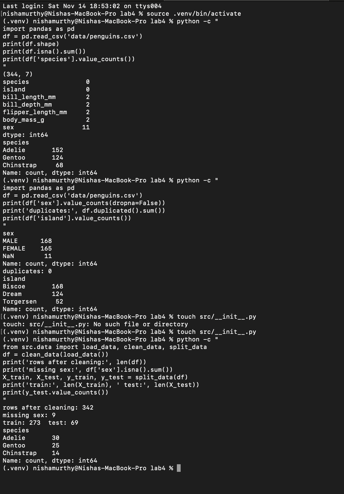

**Training output: four models compared, best one registered as the champion**

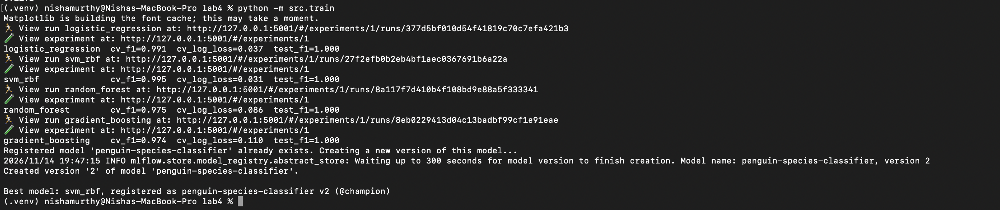

**Runs in the penguin-species experiment**

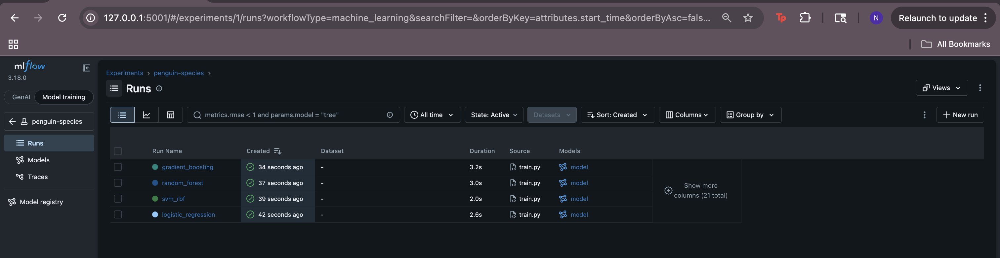

**Comparing the four runs in the MLflow UI**

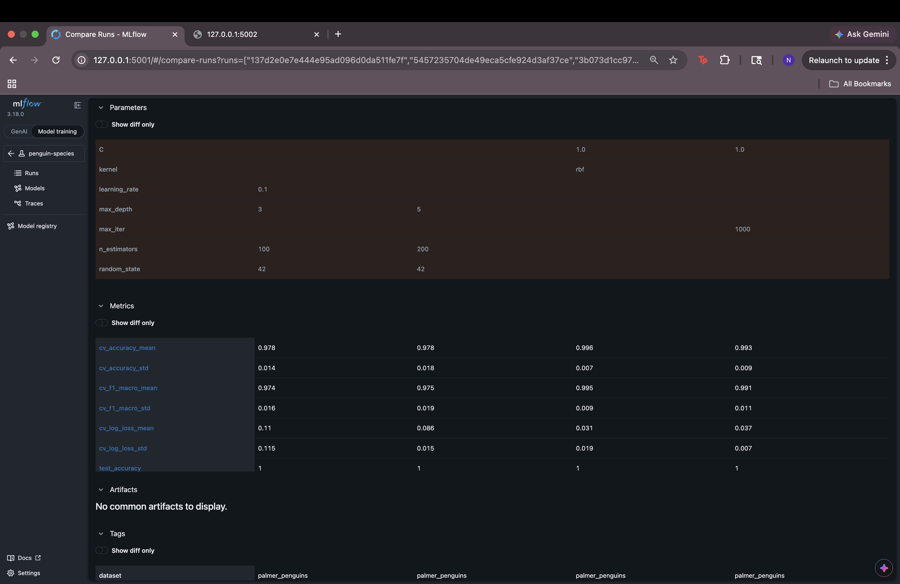

**Confusion matrix artifact**

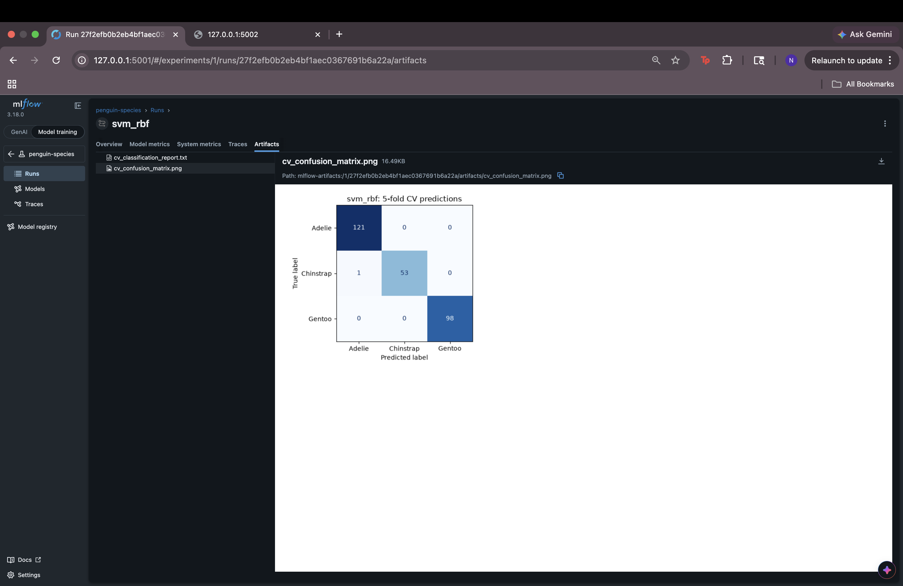

**Classification report artifact**

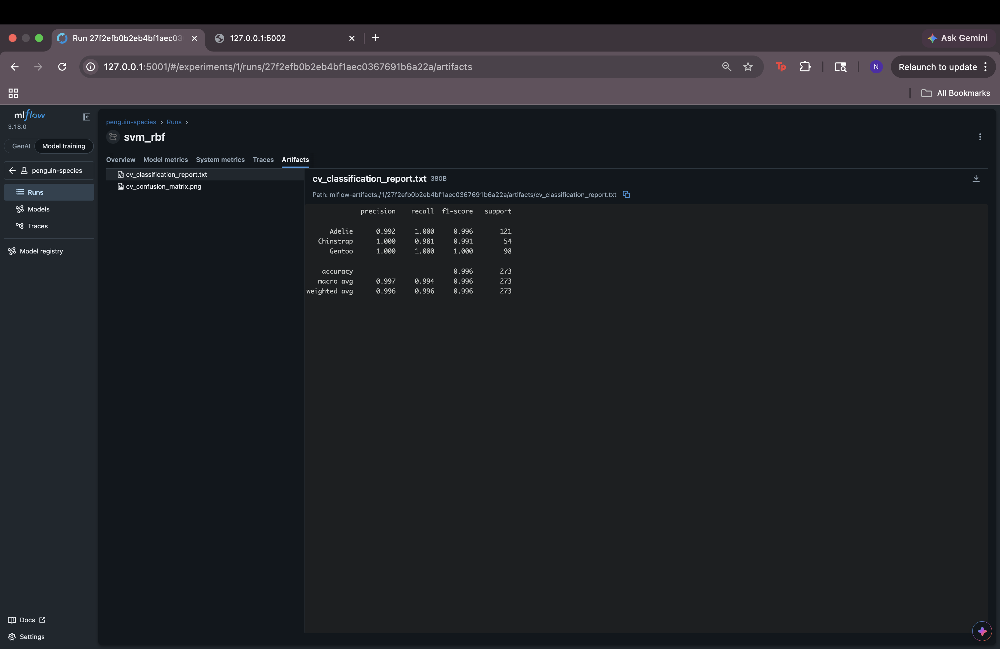

**Registered version with tags, champion alias, and schema**

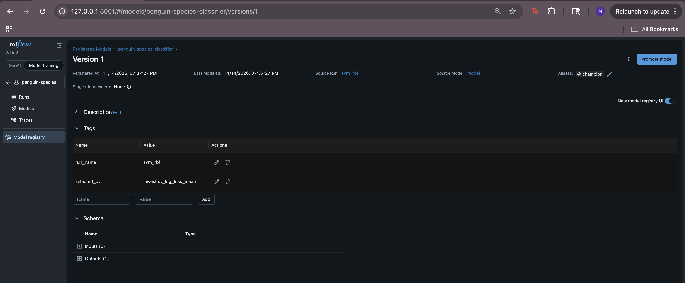

**Two registered versions, with the champion alias moved to version 2**

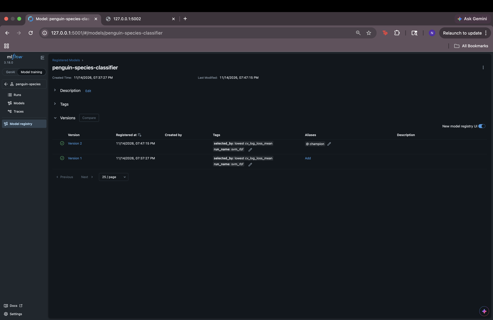

**Serving the champion model by alias**

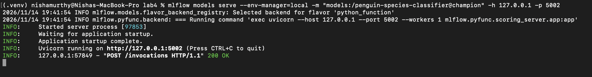

**Predictions from the served model**

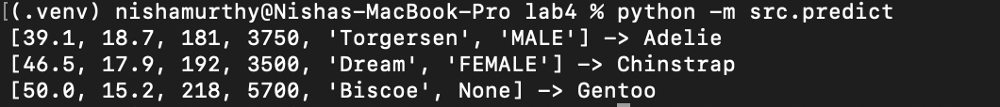

**All 19 tests passing**

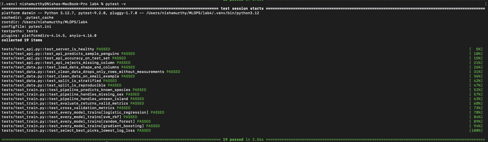
